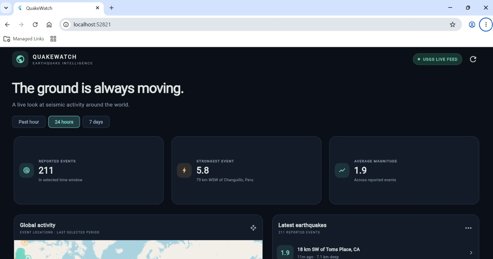
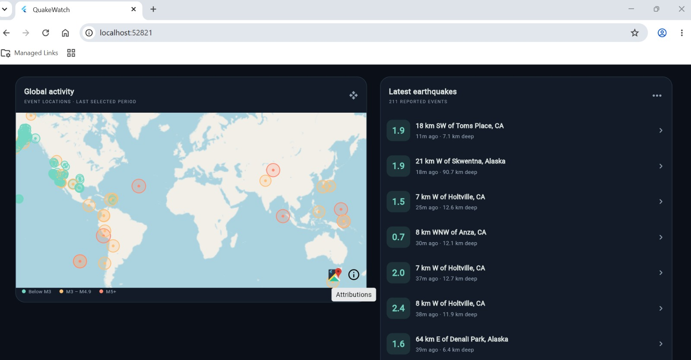
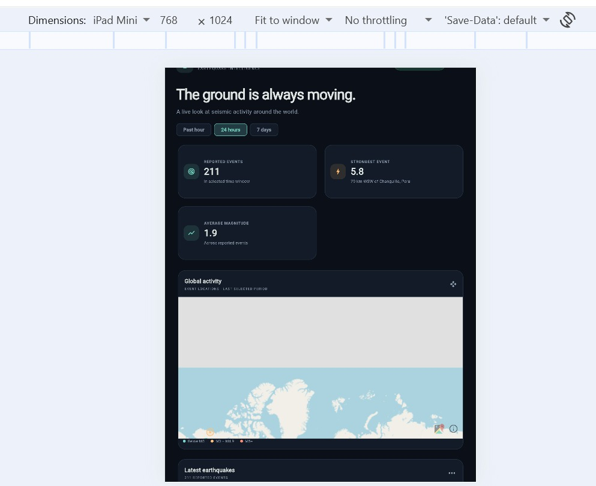
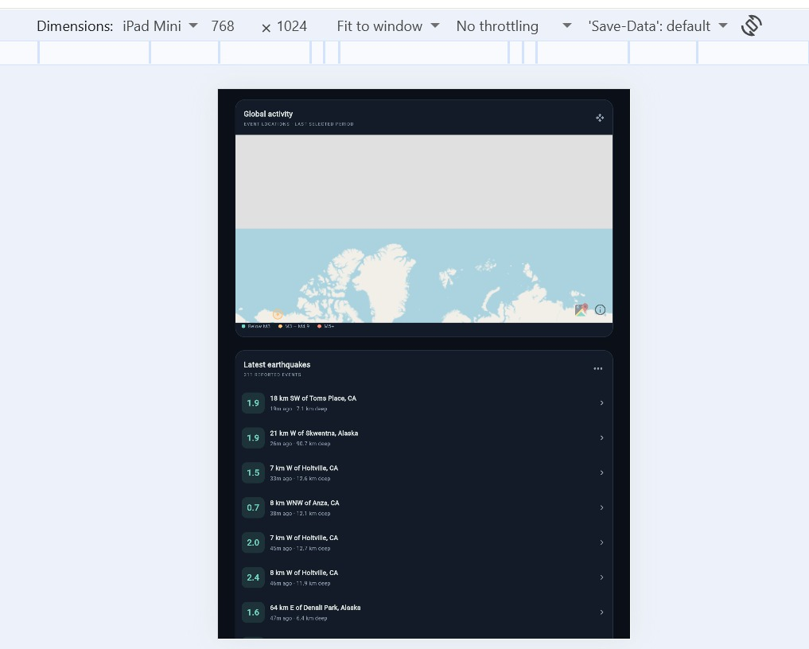
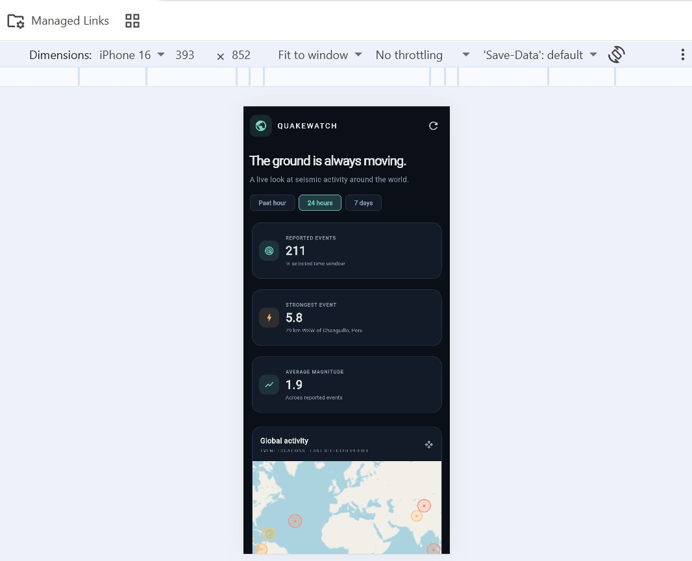
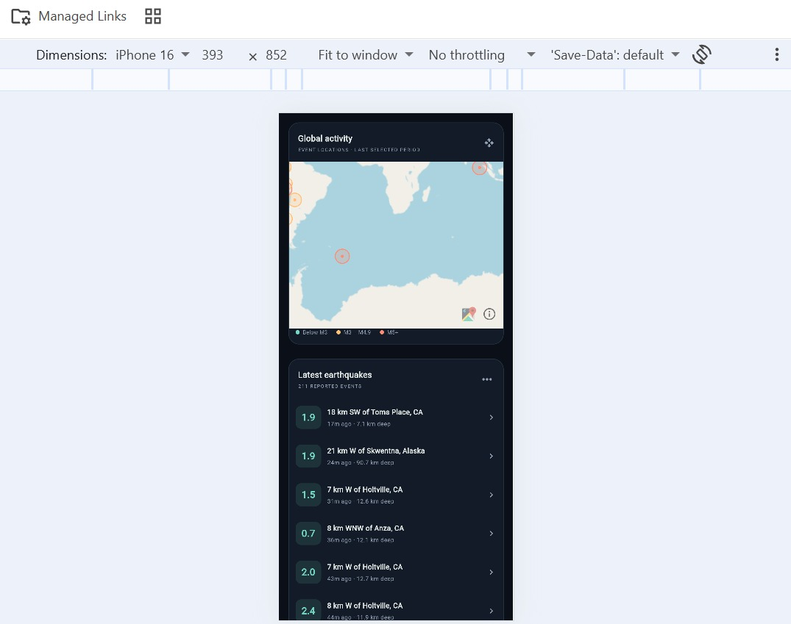

# QuakeWatch

QuakeWatch is a Flutter dashboard for monitoring recent earthquake activity around the world. It retrieves earthquake events from the United States Geological Survey (USGS) GeoJSON feeds and presents summary metrics, an interactive map, and a recent-events list.

## 📱 Screenshots

<p align="center">
  Explore QuakeWatch across Web, Tablet and Mobile devices.
</p>

<table align="center">
  <tr>
    <td align="center">
      <strong>Web Dashboard</strong><br><br>
      
    </td>
    <td align="center">
      <strong>Web Map</strong><br><br>
      
    </td>
    <td align="center">
      <strong>Tablet Dashboard</strong><br><br>
      
    </td>
  </tr>
  <tr>
    <td align="center">
      <strong>Tablet Map</strong><br><br>
      
    </td>
    <td align="center">
      <strong>Mobile Dashboard</strong><br><br>
      
    </td>
    <td align="center">
      <strong>Mobile Map</strong><br><br>
      
    </td>
  </tr>
</table>

## ✨ Features

- **Time-range filters:** Switch between the past hour, past 24 hours, and past 7 days.
- **Live USGS earthquake feed:** Loads the corresponding USGS GeoJSON summary feed.
- **Dashboard metrics:** Shows the number of reported events, strongest event, and average magnitude for the selected period.
- **Map and event list:** Displays earthquake locations alongside recent event details.
- **Refresh:** Reloads the currently selected feed.
- **Offline fallback:** Saves the most recently fetched snapshot for each time range. If a live request fails, the app attempts to show the cached snapshot and marks it as stale.
- **Responsive layout:** Adapts metric cards and map/event panels to narrower and wider screens.
- **Loading and error states:** Provides feedback while loading and a retry action when the feed cannot be loaded.

## 🛠️ Tech Stack

- [Flutter](https://flutter.dev/) and Dart
- [Riverpod](https://riverpod.dev/) for state management
- [Dio](https://pub.dev/packages/dio) for HTTP requests
- [flutter_map](https://pub.dev/packages/flutter_map) and [latlong2](https://pub.dev/packages/latlong2) for map rendering and geographic coordinates
- [shared_preferences](https://pub.dev/packages/shared_preferences) for cached snapshots

## 🌍 Data Source

Earthquake data is provided by the [USGS Earthquake Hazards Program](https://earthquake.usgs.gov/earthquakes/feed/v1.0/geojson.php).

The app uses these summary feeds:

| In-app Filter | USGS Feed |
|---|---|
| Past hour | `all_hour` |
| Past 24 hours | `all_day` |
| Past 7 days | `all_week` |

The application parses GeoJSON features and sorts events by occurrence time, newest first.

Individual malformed features are skipped rather than causing the entire feed to fail.

## 🚀 Getting Started

### Prerequisites

- Flutter SDK compatible with the Dart SDK constraint in `pubspec.yaml` (`^3.14.0`).
- A configured Flutter development environment for your target platform.
- Internet access for live USGS data (cached data may be available after a successful earlier fetch).

Check your Flutter setup:

```bash
flutter doctor
```

### Install Dependencies

From the project root, run:

```bash
flutter pub get
```

### Run the Application

For the default connected device or emulator:

```bash
flutter run
```

To list available devices:

```bash
flutter devices
```

To run on a specific device:

```bash
flutter run -d <device-id>
```

### Run Tests

```bash
flutter test
```

## 📂 Project Structure

```text
lib/
├── main.dart
└── src/
    ├── data/
    │   └── earthquake_repository.dart
    ├── domain/
    │   └── earthquake.dart
    └── widget/
        ├── dashboard_screen.dart
        └── dashboard/
            ├── dashboard_content.dart
            ├── dashboard_header.dart
            ├── dashboard_intro.dart
            ├── dashboard_theme.dart
            ├── empty_state.dart
            ├── error_panel.dart
            ├── event_panel.dart
            ├── event_row.dart
            ├── footer.dart
            ├── legend_dot.dart
            ├── loading_panel.dart
            ├── map_panel.dart
            ├── metric_card.dart
            ├── panel_heading.dart
            └── stale_notice.dart
```

## 📝 Notes

- The app starts with the **24 hours** feed selected.
- A network failure is handled by attempting to load the cached snapshot for the selected time range.
- Cached data is a fallback, not a replacement for a successful live refresh.

---

<p align="center">
  <strong>Built with Flutter ❤️</strong>
</p>